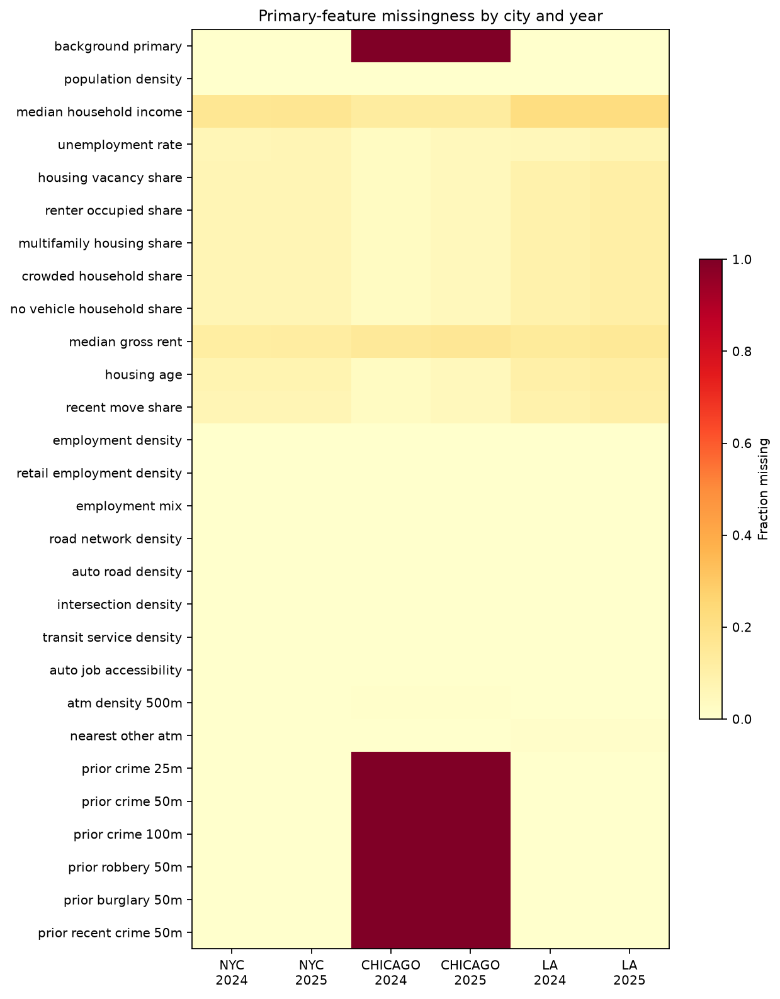
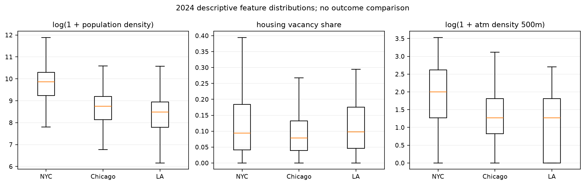

# Phase 3 descriptive results

Computational build and automated validation passed. These are feature-construction results, not evidence of predictive improvement or a causal environmental effect. Scientific review remains pending.

| City | Year | Site-years | Unique ACS joins | Unique EPA joins | ATM-density coverage |
| --- | --- | --- | --- | --- | --- |
| New York City | 2023 | 680 | 0 | 680 | 0 |
| Chicago | 2023 | 441 | 0 | 441 | 0 |
| Los Angeles | 2023 | 166 | 0 | 166 | 0 |
| New York City | 2024 | 702 | 702 | 702 | 702 |
| Chicago | 2024 | 443 | 443 | 443 | 440 |
| Los Angeles | 2024 | 174 | 174 | 174 | 174 |
| New York City | 2025 | 750 | 750 | 750 | 750 |
| Chicago | 2025 | 482 | 482 | 482 | 479 |
| Los Angeles | 2025 | 180 | 180 | 180 | 180 |

## Missingness exceeding 20% in a main city/year

| City | Year | Feature | Missing / rows |
| --- | --- | --- | --- |
| Chicago | 2024 | log1p_background_primary | 443 / 443 |
| Chicago | 2024 | log1p_prior_crime_25m | 443 / 443 |
| Chicago | 2024 | log1p_prior_crime_50m | 443 / 443 |
| Chicago | 2024 | log1p_prior_crime_100m | 443 / 443 |
| Chicago | 2024 | log1p_prior_robbery_50m | 443 / 443 |
| Chicago | 2024 | log1p_prior_burglary_50m | 443 / 443 |
| Chicago | 2024 | log1p_prior_recent_crime_50m | 443 / 443 |
| Los Angeles | 2024 | log1p_median_household_income | 38 / 174 |
| Chicago | 2025 | log1p_background_primary | 482 / 482 |
| Chicago | 2025 | log1p_prior_crime_25m | 482 / 482 |
| Chicago | 2025 | log1p_prior_crime_50m | 482 / 482 |
| Chicago | 2025 | log1p_prior_crime_100m | 482 / 482 |
| Chicago | 2025 | log1p_prior_robbery_50m | 482 / 482 |
| Chicago | 2025 | log1p_prior_burglary_50m | 482 / 482 |
| Chicago | 2025 | log1p_prior_recent_crime_50m | 482 / 482 |
| Los Angeles | 2025 | log1p_median_household_income | 40 / 180 |

Chicago's seven report-filtered crime variables are unavailable by design. Partial 2023 additionally lacks all 11 ACS and both ATM-competition predictors at its cutoff; it is a separate limited supplement. Other blanks retain their source or join meaning. No missing values were replaced by zero or globally imputed.

There are 2 main city/year feature-pair flags with absolute Spearman correlation >=0.90. Both concern Los Angeles's prior full-year and July–December crime counts within 50 m (2024 rho 0.957; 2025 rho 0.903). No predictors were dropped on this basis. See [all correlations](../qa/feature_correlations.csv), [distributions](../qa/feature_distributions.csv) and [join/availability summary](../qa/join_and_availability_summary.csv).

The invalid-source-geometry policy affects 0 cohort rows. See [geometry diagnostics](../qa/geometry_repairs.csv) and [per-row joins](../qa/spatial_join_audit.csv); unusable geometry is not accepted as a repaired source polygon.

The OSM sampling/identity limitations, public block crime coordinates, LA source transition, unavailable Chicago report dates and fixed old context vintages remain material. A three-city model must explicitly address Chicago's absent primary baseline rather than treating its unknown availability as zero. Phase 4 was not executed.
