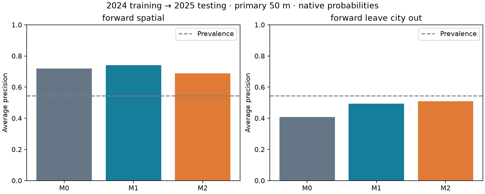
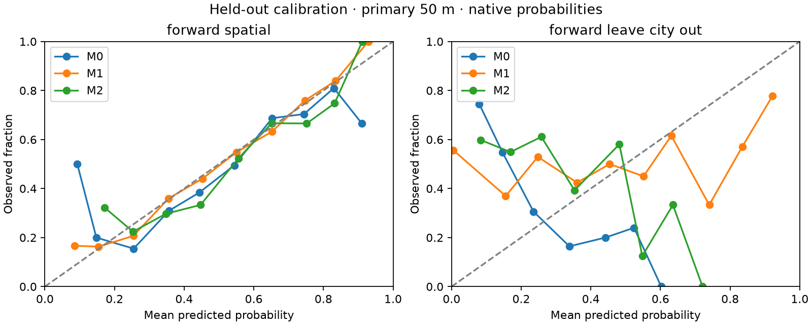

# Phase 4 — 2024-to-2025 model comparisons

Computationally complete and validated: **141 fold models**, **44,376 held-out prediction rows**, six variants and two forward evaluation schemes. Independent scientific approval remains pending.

Neither environmental model met the primary pooled numerical improvement criterion. This evaluation does not demonstrate reliable incremental improvement; it does not prove that environmental effects are absent.

- [Complete step-by-step procedure](docs/01_step_by_step.md)
- [Methods and limitations](docs/02_methods.md)
- [Results, sensitivities and calibration](docs/03_results.md)
- [Exact reproduction commands](docs/04_reproduce.md)
- [Artifact guide](docs/05_artifacts.md)
- [Metrics](data/metrics.csv), [paired comparisons](data/paired_ap_comparisons.csv), [predictions](data/predictions.csv), [validation](qa/validation.json)

No phase 5 adaptation or deployment was performed. These are nearby-crime outcomes in a retrospectively constructed cohort, not verified ATM-attack risks.
