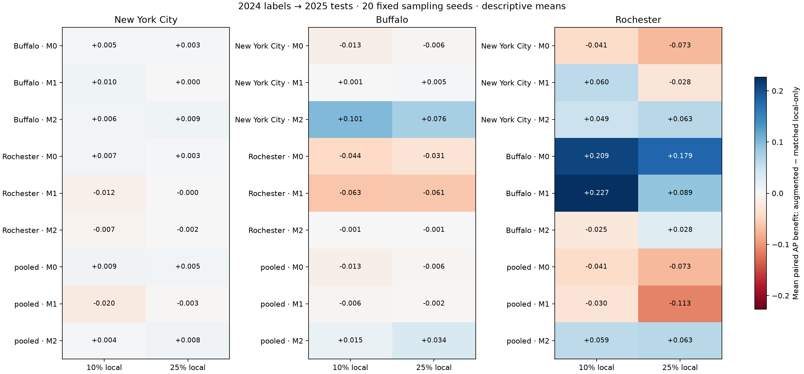
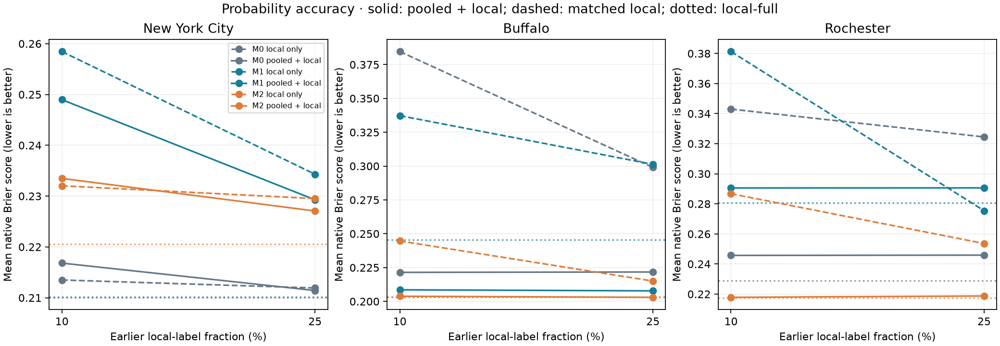
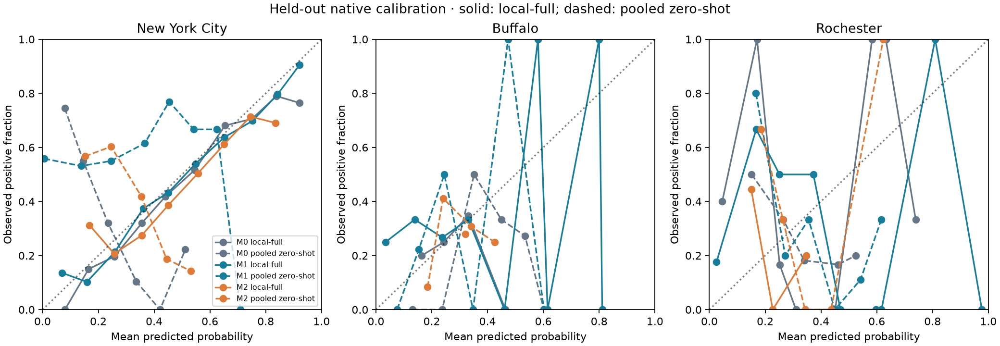

# Phase 5 — city-transfer experiments, 2024 → 2025

Computationally complete and validated: **7,380 model evaluations**, **7,155 unique saved fits**, **610,572 held-out predictions**, **20 sampling seeds**. Independent scientific review remains pending.

Transfer effects are mixed across cities, model families, source cities and adaptation fractions. Adding source data sometimes helps and sometimes harms the exactly matched local-only model; there is no demonstrated universal transfer benefit.

- [Complete step-by-step procedure](docs/01_step_by_step.md)
- [Methods and limitations](docs/02_methods.md)
- [Full results and interpretation](docs/03_results.md)
- [Reproduction commands](docs/04_reproduce.md)
- [Artifact guide](docs/05_artifacts.md)
- [Transfer benefits](data/benefit_summary.csv), [transfer gaps](data/transfer_gaps.csv), [all metrics](data/metrics.csv), [validation](qa/validation.json)

The 20-seed percentiles are sampling summaries, not confidence intervals. Phase 4's primary improvement criterion failed; these are descriptive follow-on experiments, not confirmation or deployment approval.
