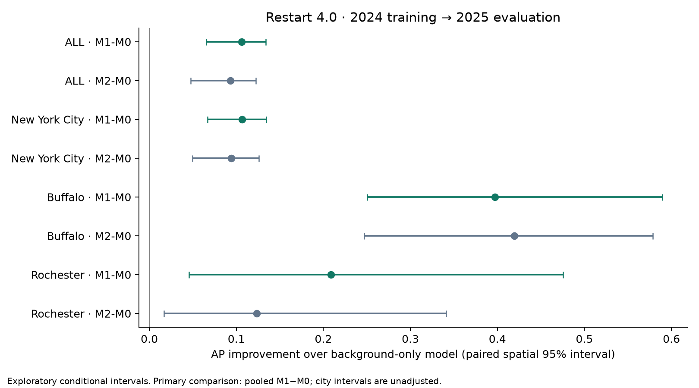

# Phase 4 results

**Validation: PASS.** 24 outer models, 7,446 prediction rows; all final models replay exactly.

| scheme | city | model | average_precision | roc_auc | brier_score | top_decile_precision |
| --- | --- | --- | --- | --- | --- | --- |
| forward_spatial | ALL | M0 | 0.7195 | 0.7242 | 0.2112 | 0.7680 |
| forward_spatial | ALL | M1 | 0.8254 | 0.7919 | 0.1868 | 0.9440 |
| forward_spatial | ALL | M2 | 0.8124 | 0.7748 | 0.1917 | 0.9520 |
| forward_spatial | New York City | M0 | 0.7264 | 0.7199 | 0.2095 | 0.7586 |
| forward_spatial | New York City | M1 | 0.8328 | 0.7874 | 0.1874 | 0.9569 |
| forward_spatial | New York City | M2 | 0.8206 | 0.7721 | 0.1917 | 0.9569 |
| forward_spatial | Buffalo | M0 | 0.2996 | 0.5139 | 0.2261 | 0.2000 |
| forward_spatial | Buffalo | M1 | 0.6967 | 0.7500 | 0.1613 | 1.0000 |
| forward_spatial | Buffalo | M2 | 0.7188 | 0.7411 | 0.1761 | 1.0000 |
| forward_spatial | Rochester | M0 | 0.2221 | 0.3342 | 0.2494 | 0.0000 |
| forward_spatial | Rochester | M1 | 0.4309 | 0.6440 | 0.2070 | 0.2500 |
| forward_spatial | Rochester | M2 | 0.3457 | 0.6087 | 0.2155 | 0.2500 |
| forward_leave_city_out | ALL | M0 | 0.4077 | 0.2697 | 0.4410 | 0.1840 |
| forward_leave_city_out | ALL | M1 | 0.6314 | 0.5124 | 0.3398 | 0.8000 |
| forward_leave_city_out | ALL | M2 | 0.5394 | 0.4207 | 0.3790 | 0.2000 |
| forward_leave_city_out | New York City | M0 | 0.4257 | 0.2764 | 0.4557 | 0.1897 |
| forward_leave_city_out | New York City | M1 | 0.6444 | 0.5140 | 0.3512 | 0.7931 |
| forward_leave_city_out | New York City | M2 | 0.5574 | 0.4435 | 0.3926 | 0.2931 |
| forward_leave_city_out | Buffalo | M0 | 0.2938 | 0.5089 | 0.2213 | 0.2000 |
| forward_leave_city_out | Buffalo | M1 | 0.7011 | 0.7629 | 0.1579 | 1.0000 |
| forward_leave_city_out | Buffalo | M2 | 0.6547 | 0.7351 | 0.1770 | 1.0000 |
| forward_leave_city_out | Rochester | M0 | 0.2210 | 0.3397 | 0.2455 | 0.0000 |
| forward_leave_city_out | Rochester | M1 | 0.4309 | 0.6467 | 0.2054 | 0.2500 |
| forward_leave_city_out | Rochester | M2 | 0.3722 | 0.6196 | 0.1976 | 0.2500 |

## Paired AP differences

| scheme | city | comparison | ap_difference | ci_low | ci_high | primary | numerical_gate |
| --- | --- | --- | --- | --- | --- | --- | --- |
| forward_spatial | ALL | M1-M0 | 0.1059 | 0.0652 | 0.1336 | True | True |
| forward_spatial | ALL | M2-M0 | 0.0929 | 0.0473 | 0.1223 | False | True |
| forward_spatial | New York City | M1-M0 | 0.1064 | 0.0669 | 0.1344 | False | True |
| forward_spatial | New York City | M2-M0 | 0.0942 | 0.0497 | 0.1257 | False | True |
| forward_spatial | Buffalo | M1-M0 | 0.3971 | 0.2504 | 0.5896 | False | True |
| forward_spatial | Buffalo | M2-M0 | 0.4193 | 0.2470 | 0.5785 | False | True |
| forward_spatial | Rochester | M1-M0 | 0.2088 | 0.0458 | 0.4753 | False | True |
| forward_spatial | Rochester | M2-M0 | 0.1236 | 0.0167 | 0.3410 | False | True |
| forward_leave_city_out | ALL | M1-M0 | 0.2237 | 0.1875 | 0.2581 | False | True |
| forward_leave_city_out | ALL | M2-M0 | 0.1317 | 0.1149 | 0.1460 | False | True |
| forward_leave_city_out | New York City | M1-M0 | 0.2187 | 0.1807 | 0.2511 | False | True |
| forward_leave_city_out | New York City | M2-M0 | 0.1317 | 0.1096 | 0.1458 | False | True |
| forward_leave_city_out | Buffalo | M1-M0 | 0.4073 | 0.2567 | 0.5912 | False | True |
| forward_leave_city_out | Buffalo | M2-M0 | 0.3609 | 0.1984 | 0.5598 | False | True |
| forward_leave_city_out | Rochester | M1-M0 | 0.2098 | 0.0358 | 0.4735 | False | True |
| forward_leave_city_out | Rochester | M2-M0 | 0.1512 | 0.0275 | 0.3390 | False | True |

Primary M1−M0 satisfies the frozen numerical criterion. Other intervals are descriptive and unadjusted. All intervals condition on fitted predictions and previously inspected outcomes.

## Training-only feature comparison

| candidate | mean_2024_inner_AP | selected_outer_folds |
| --- | --- | --- |
| log1p_prior_crime_50m | 0.7586 | 5 |
| log1p_prior_robbery_50m | 0.7461 | 0 |
| log1p_prior_recent_crime_50m | 0.7301 | 0 |
| log1p_prior_burglary_50m | 0.7136 | 0 |
| log1p_prior_crime_100m | 0.7039 | 0 |
| log1p_prior_crime_25m | 0.6995 | 0 |
| no_vehicle_household_share | 0.6870 | 0 |
| log1p_median_household_income | 0.6855 | 0 |
| renter_occupied_share | 0.6827 | 0 |
| multifamily_housing_share | 0.6811 | 0 |
| log1p_median_gross_rent | 0.6805 | 0 |
| employment_mix | 0.6784 | 0 |
| log1p_nearest_other_atm | 0.6779 | 0 |
| log1p_intersection_density | 0.6757 | 0 |
| unemployment_rate | 0.6754 | 0 |
| log1p_auto_job_accessibility | 0.6748 | 0 |
| log1p_transit_service_density | 0.6746 | 0 |
| log1p_employment_density | 0.6736 | 0 |
| log1p_atm_density_500m | 0.6735 | 0 |
| NONE | 0.6735 | 0 |
| log1p_retail_employment_density | 0.6727 | 0 |
| log1p_auto_road_density | 0.6721 | 0 |
| log1p_population_density | 0.6720 | 0 |
| housing_vacancy_share | 0.6697 | 0 |
| log1p_road_network_density | 0.6687 | 0 |
| log1p_housing_age | 0.6684 | 0 |
| recent_move_share | 0.6669 | 0 |
| crowded_household_share | 0.6480 | 0 |

Scores average the five spatial outer fits’ internal 2024 validation scores; overlapping fits are dependent. The 50 m prior-crime feature wins all five spatial selections. One of the three city-held-out selections instead chooses prior burglary at 50 m.

See [methods](../../../reports/methods.md) for temporal restrictions, selection, uncertainty and limitations.
