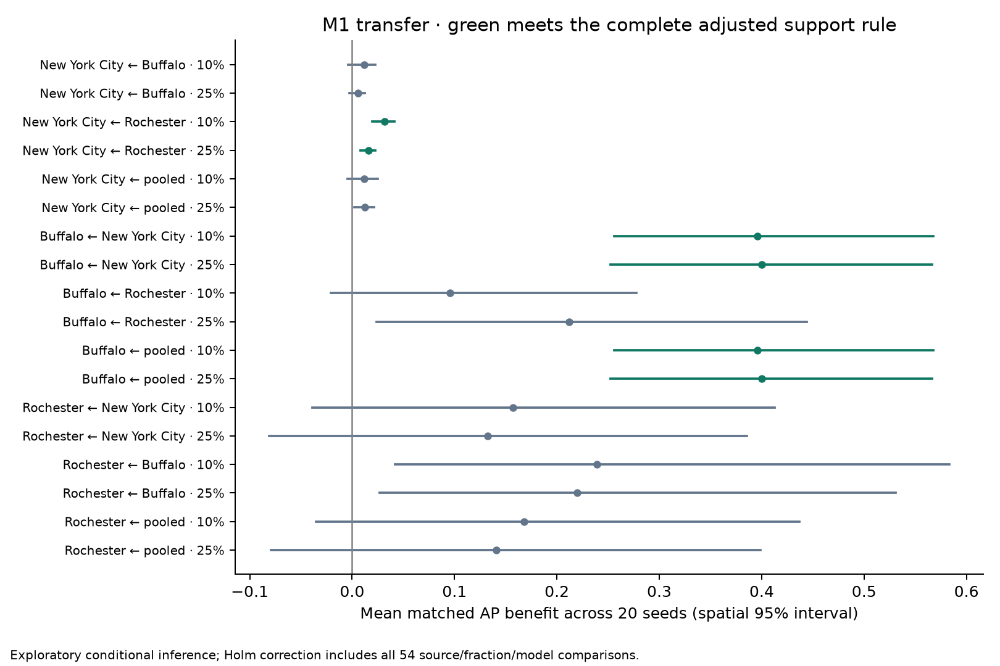

# Phase 5 results

**Validation: PASS.** 7,380 evaluations, 7,155 unique models, 2,385 nested selections and 610,572 predictions. There are 267 flagged single-class models and 0 estimator warnings.

**9 of 54 comparisons** meet the exploratory support rule. Positive seed means alone do not establish significance. The complete family below uses 2,000 spatial bootstraps, 9,999 block-swap permutations and Holm adjustment across all 54 tests.

| city | source | fraction | model | ap_difference | ci_low | ci_high | positive_seeds | holm_p | supported_exploratory_benefit |
| --- | --- | --- | --- | --- | --- | --- | --- | --- | --- |
| New York City | Buffalo | 0.1 | M0 | 0.0049 | -0.0052 | 0.0128 | 18 | 1.0000 | False |
| New York City | Buffalo | 0.1 | M1 | 0.0116 | -0.0042 | 0.0227 | 10 | 1.0000 | False |
| New York City | Buffalo | 0.1 | M2 | 0.0102 | 0.0016 | 0.0184 | 12 | 1.0000 | False |
| New York City | Buffalo | 0.25 | M0 | 0.0026 | -0.0008 | 0.0065 | 20 | 1.0000 | False |
| New York City | Buffalo | 0.25 | M1 | 0.0057 | -0.0030 | 0.0125 | 13 | 1.0000 | False |
| New York City | Buffalo | 0.25 | M2 | 0.0056 | -0.0019 | 0.0132 | 14 | 1.0000 | False |
| New York City | Rochester | 0.1 | M0 | 0.0067 | -0.0013 | 0.0139 | 20 | 1.0000 | False |
| New York City | Rochester | 0.1 | M1 | 0.0318 | 0.0199 | 0.0416 | 18 | 0.0054 | True |
| New York City | Rochester | 0.1 | M2 | 0.0268 | 0.0178 | 0.0373 | 17 | 0.0054 | True |
| New York City | Rochester | 0.25 | M0 | 0.0026 | -0.0001 | 0.0056 | 20 | 1.0000 | False |
| New York City | Rochester | 0.25 | M1 | 0.0159 | 0.0082 | 0.0227 | 20 | 0.0100 | True |
| New York City | Rochester | 0.25 | M2 | 0.0168 | 0.0087 | 0.0251 | 19 | 0.0329 | True |
| New York City | pooled | 0.1 | M0 | 0.0086 | -0.0125 | 0.0240 | 19 | 1.0000 | False |
| New York City | pooled | 0.1 | M1 | 0.0115 | -0.0046 | 0.0251 | 11 | 1.0000 | False |
| New York City | pooled | 0.1 | M2 | 0.0218 | 0.0123 | 0.0321 | 17 | 0.0329 | True |
| New York City | pooled | 0.25 | M0 | 0.0055 | -0.0018 | 0.0125 | 20 | 1.0000 | False |
| New York City | pooled | 0.25 | M1 | 0.0123 | 0.0020 | 0.0212 | 17 | 1.0000 | False |
| New York City | pooled | 0.25 | M2 | 0.0127 | 0.0042 | 0.0217 | 15 | 0.3075 | False |
| Buffalo | New York City | 0.1 | M0 | -0.0127 | -0.0556 | 0.0274 | 9 | 1.0000 | False |
| Buffalo | New York City | 0.1 | M1 | 0.3960 | 0.2562 | 0.5678 | 20 | 0.0054 | True |
| Buffalo | New York City | 0.1 | M2 | 0.3642 | 0.2262 | 0.5708 | 20 | 0.1496 | False |
| Buffalo | New York City | 0.25 | M0 | -0.0063 | -0.0558 | 0.0272 | 9 | 1.0000 | False |
| Buffalo | New York City | 0.25 | M1 | 0.3998 | 0.2524 | 0.5666 | 20 | 0.0147 | True |
| Buffalo | New York City | 0.25 | M2 | 0.3596 | 0.2162 | 0.5718 | 20 | 1.0000 | False |
| Buffalo | Rochester | 0.1 | M0 | -0.0443 | -0.0861 | 0.0302 | 3 | 1.0000 | False |
| Buffalo | Rochester | 0.1 | M1 | 0.0953 | -0.0206 | 0.2778 | 17 | 0.7683 | False |
| Buffalo | Rochester | 0.1 | M2 | -0.0008 | -0.0047 | 0.0108 | 4 | 1.0000 | False |
| Buffalo | Rochester | 0.25 | M0 | -0.0313 | -0.0812 | 0.0372 | 4 | 1.0000 | False |
| Buffalo | Rochester | 0.25 | M1 | 0.2119 | 0.0238 | 0.4439 | 20 | 1.0000 | False |
| Buffalo | Rochester | 0.25 | M2 | -0.0008 | -0.0056 | 0.0119 | 2 | 1.0000 | False |
| Buffalo | pooled | 0.1 | M0 | -0.0127 | -0.0556 | 0.0274 | 9 | 1.0000 | False |
| Buffalo | pooled | 0.1 | M1 | 0.3960 | 0.2562 | 0.5678 | 20 | 0.0054 | True |
| Buffalo | pooled | 0.1 | M2 | 0.3567 | 0.2149 | 0.5650 | 20 | 0.2184 | False |
| Buffalo | pooled | 0.25 | M0 | -0.0063 | -0.0558 | 0.0272 | 9 | 1.0000 | False |
| Buffalo | pooled | 0.25 | M1 | 0.3998 | 0.2524 | 0.5666 | 20 | 0.0147 | True |
| Buffalo | pooled | 0.25 | M2 | 0.3629 | 0.2194 | 0.5725 | 20 | 1.0000 | False |
| Rochester | New York City | 0.1 | M0 | -0.0410 | -0.1112 | 0.0462 | 1 | 1.0000 | False |
| Rochester | New York City | 0.1 | M1 | 0.1569 | -0.0388 | 0.4126 | 20 | 1.0000 | False |
| Rochester | New York City | 0.1 | M2 | 0.0840 | -0.0136 | 0.2402 | 19 | 1.0000 | False |
| Rochester | New York City | 0.25 | M0 | -0.0727 | -0.1888 | 0.0283 | 1 | 1.0000 | False |
| Rochester | New York City | 0.25 | M1 | 0.1323 | -0.0809 | 0.3858 | 19 | 1.0000 | False |
| Rochester | New York City | 0.25 | M2 | 0.0904 | -0.0236 | 0.2398 | 20 | 1.0000 | False |
| Rochester | Buffalo | 0.1 | M0 | 0.2086 | 0.0212 | 0.4763 | 20 | 0.1720 | False |
| Rochester | Buffalo | 0.1 | M1 | 0.2392 | 0.0422 | 0.5833 | 20 | 1.0000 | False |
| Rochester | Buffalo | 0.1 | M2 | 0.1082 | 0.0126 | 0.2868 | 19 | 1.0000 | False |
| Rochester | Buffalo | 0.25 | M0 | 0.1792 | -0.0035 | 0.4076 | 20 | 0.1080 | False |
| Rochester | Buffalo | 0.25 | M1 | 0.2198 | 0.0270 | 0.5308 | 20 | 1.0000 | False |
| Rochester | Buffalo | 0.25 | M2 | 0.1816 | 0.0346 | 0.3970 | 20 | 0.6880 | False |
| Rochester | pooled | 0.1 | M0 | -0.0410 | -0.1112 | 0.0462 | 1 | 1.0000 | False |
| Rochester | pooled | 0.1 | M1 | 0.1678 | -0.0350 | 0.4371 | 20 | 1.0000 | False |
| Rochester | pooled | 0.1 | M2 | 0.1065 | -0.0078 | 0.2885 | 20 | 1.0000 | False |
| Rochester | pooled | 0.25 | M0 | -0.0727 | -0.1888 | 0.0283 | 1 | 1.0000 | False |
| Rochester | pooled | 0.25 | M1 | 0.1407 | -0.0795 | 0.3987 | 19 | 1.0000 | False |
| Rochester | pooled | 0.25 | M2 | 0.1191 | -0.0153 | 0.3102 | 20 | 1.0000 | False |

## Local-full and zero-shot results

| city | condition | source | model | average_precision | brier_score |
| --- | --- | --- | --- | --- | --- |
| New York City | local_full | target | M0 | 0.7251 | 0.2101 |
| New York City | local_full | target | M1 | 0.8190 | 0.1905 |
| New York City | local_full | target | M2 | 0.8031 | 0.1946 |
| New York City | source_only | Buffalo | M0 | 0.4257 | 0.4423 |
| New York City | source_only | Buffalo | M1 | 0.6460 | 0.2964 |
| New York City | source_only | Buffalo | M2 | 0.5621 | 0.2985 |
| New York City | source_only | Rochester | M0 | 0.4257 | 0.4791 |
| New York City | source_only | Rochester | M1 | 0.4741 | 0.5037 |
| New York City | source_only | Rochester | M2 | 0.5621 | 0.3435 |
| New York City | source_only | pooled | M0 | 0.4257 | 0.4557 |
| New York City | source_only | pooled | M1 | 0.6444 | 0.3512 |
| New York City | source_only | pooled | M2 | 0.5574 | 0.3926 |
| Buffalo | local_full | target | M0 | 0.3038 | 0.2034 |
| Buffalo | local_full | target | M1 | 0.3799 | 0.2117 |
| Buffalo | local_full | target | M2 | 0.2870 | 0.2031 |
| Buffalo | source_only | New York City | M0 | 0.2938 | 0.2219 |
| Buffalo | source_only | New York City | M1 | 0.7011 | 0.1589 |
| Buffalo | source_only | New York City | M2 | 0.6573 | 0.1770 |
| Buffalo | source_only | Rochester | M0 | 0.2710 | 0.2267 |
| Buffalo | source_only | Rochester | M1 | 0.3127 | 0.2204 |
| Buffalo | source_only | Rochester | M2 | 0.2800 | 0.2025 |
| Buffalo | source_only | pooled | M0 | 0.2938 | 0.2213 |
| Buffalo | source_only | pooled | M1 | 0.7011 | 0.1579 |
| Buffalo | source_only | pooled | M2 | 0.6547 | 0.1770 |
| Rochester | local_full | target | M0 | 0.3336 | 0.2289 |
| Rochester | local_full | target | M1 | 0.3524 | 0.2336 |
| Rochester | local_full | target | M2 | 0.2139 | 0.2175 |
| Rochester | source_only | New York City | M0 | 0.2210 | 0.2439 |
| Rochester | source_only | New York City | M1 | 0.4182 | 0.2066 |
| Rochester | source_only | New York City | M2 | 0.3331 | 0.2234 |
| Rochester | source_only | Buffalo | M0 | 0.4700 | 0.1770 |
| Rochester | source_only | Buffalo | M1 | 0.4902 | 0.1876 |
| Rochester | source_only | Buffalo | M2 | 0.2581 | 0.1971 |
| Rochester | source_only | pooled | M0 | 0.2210 | 0.2455 |
| Rochester | source_only | pooled | M1 | 0.4309 | 0.2054 |
| Rochester | source_only | pooled | M2 | 0.3722 | 0.1976 |

## Interpretation

Adding source data can help or harm, depending on the target, source and available target labels. The primary Phase 4 improvement from lagged nearby crime does not imply that adding source-city observations improves an already strong target-only model. Small-city estimates use only 50 Buffalo and 31 Rochester test sites. No city/source/seed condition was discarded.

The seed percentile columns in `benefit_uncertainty.csv` describe training-sample variation. The spatial intervals resample the target geography jointly across seeds. The adjusted randomization p-values assume exchangeable model-prediction pairs within spatial blocks; they condition on fitted models. These previously inspected retrospective outcomes cannot provide independent confirmation.

All conditions have ten-bin calibration summaries in `data/calibration_bins.csv`. Source-to-target observed feature ranges and target missingness are recorded for all 252 city/source/feature combinations in `data/feature_extrapolation.csv`. These describe distribution differences without selecting sources or changing probabilities after evaluation.

See [methods](../../../reports/methods.md), [all metrics](../data/metrics.csv), [all seed benefits](../data/transfer_benefits.csv) and [validation](../qa/validation.json).
