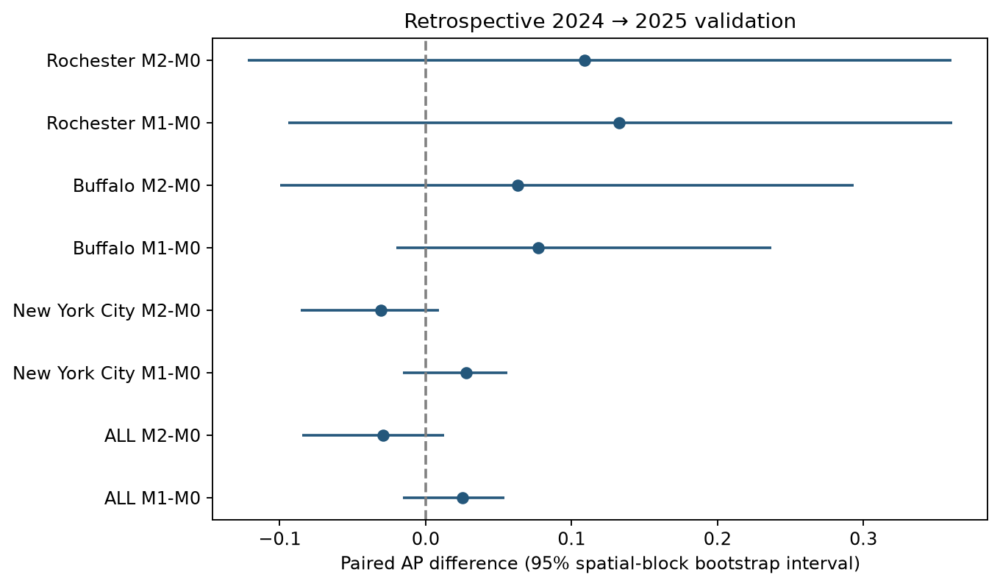

# Phase 4 temporal supplement

The retrospective temporal computation and automated validation are complete. This extends the preserved [same-year phase 4 release](../README.md), resolving its missing earlier training year. Full confirmatory research acceptance is still pending.

1201 eligible 2024 sites train the models; 1192 2025 sites form the test cohort. Fifteen outer-fold models use nested spatial validation and training-only calibration. No comparison passed the prespecified numerical AP-gain gate.

- [What was completed](docs/01_work_completed.md)
- [How it was done](docs/02_methods.md)
- [Results and interpretation](docs/03_results.md)
- [Reproduction and files](docs/04_reproduce.md)

| model | average_precision | roc_auc | brier_score |
| --- | --- | --- | --- |
| M0 | 0.7189 | 0.7222 | 0.2115 |
| M1 | 0.7440 | 0.7180 | 0.2122 |
| M2 | 0.6899 | 0.6899 | 0.2212 |

See [validation](qa/validation.json), [status](qa/status.json), [paired comparisons](data/paired_ap_comparisons.csv), and [the shared data](../../temporal_data/README.md).

