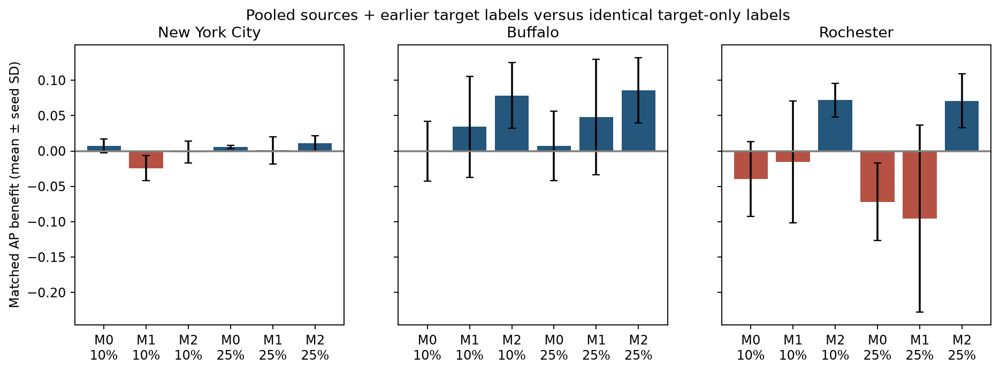

# Phase 5 city-transfer results

The prespecified retrospective transfer experiment ladder and automated validation are complete. This is a descriptive analysis: the phase 4 numerical gate did not pass, and independent research review remains pending.

Completed 7,380 model evaluations across 2,460 city/fold/training conditions, using 7,107 unique fits and 586,464 held-out predictions. Each city has local-full, both single-source zero-shot, pooled-source, and source-plus-10%/25% target experiments with exactly matched target-only controls across 20 fixed seeds.

- [What was completed](docs/01_work_completed.md)
- [How it was done](docs/02_methods.md)
- [Results and interpretation](docs/03_results.md)
- [Reproduction and files](docs/04_reproduce.md)

| city | source | model | local AP | source AP | transfer gap |
| --- | --- | --- | --- | --- | --- |
| New York City | pooled | M0 | 0.7238 | 0.4277 | 0.2961 |
| New York City | pooled | M1 | 0.7515 | 0.5129 | 0.2386 |
| New York City | pooled | M2 | 0.6940 | 0.5248 | 0.1692 |
| Buffalo | pooled | M0 | 0.3529 | 0.3307 | 0.0223 |
| Buffalo | pooled | M1 | 0.3350 | 0.3741 | -0.0391 |
| Buffalo | pooled | M2 | 0.3180 | 0.4620 | -0.1440 |
| Rochester | pooled | M0 | 0.3513 | 0.2193 | 0.1320 |
| Rochester | pooled | M1 | 0.3168 | 0.2460 | 0.0709 |
| Rochester | pooled | M2 | 0.2152 | 0.2988 | -0.0836 |

[Detailed benefit distributions](data/benefit_summary.csv), [all metrics](data/metrics.csv), [validation](qa/validation.json), [status](qa/status.json), [shared data](../temporal_data/README.md).

